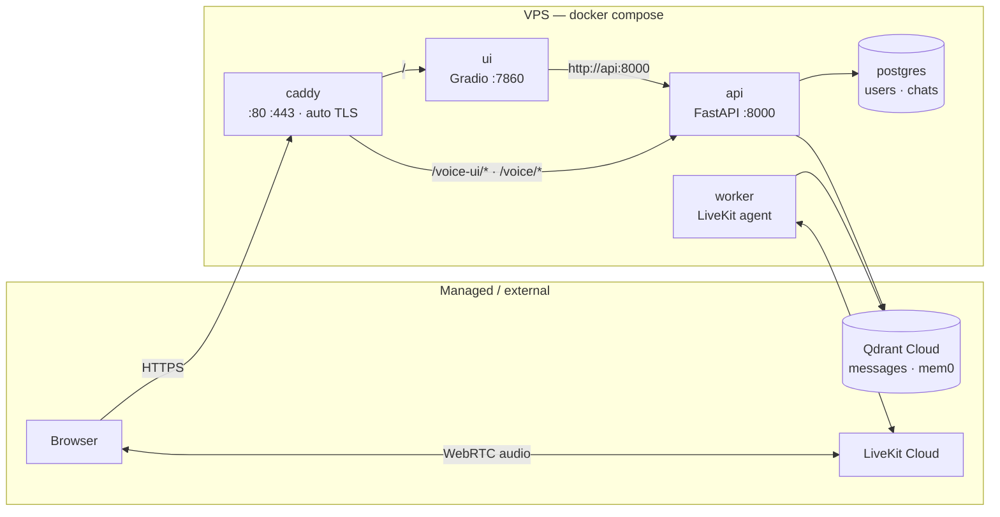
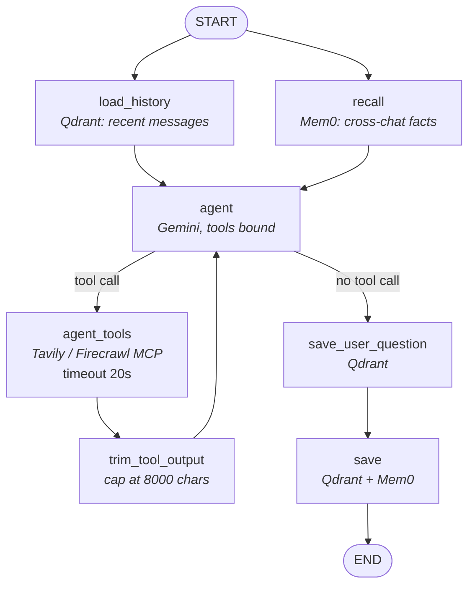
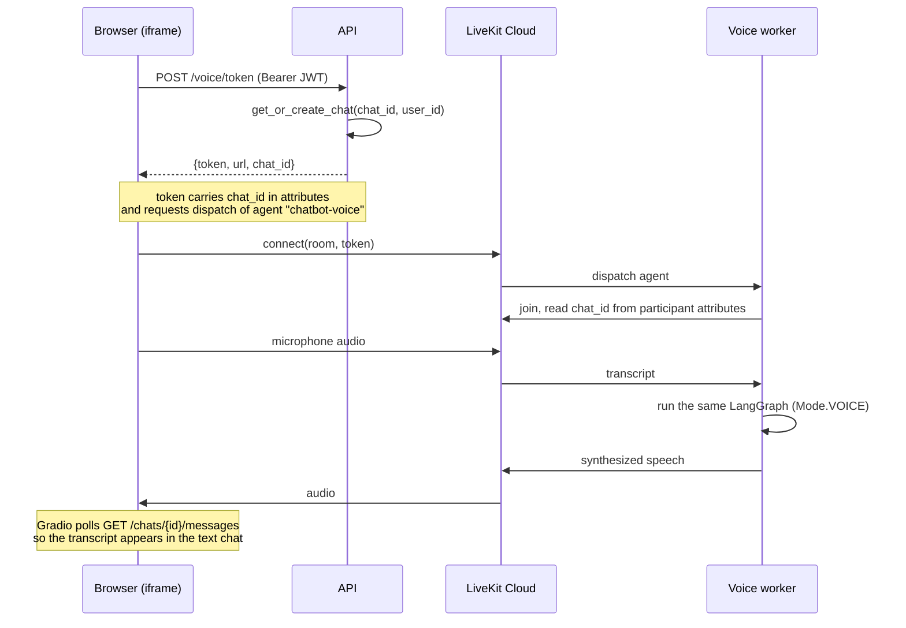

# LangGraph Chatbot — Vector Store, Memory, MCP Tools and Voice Mode

[]()
[](mailto:roman.ovsepian@extrawest.com)
[]()
[](https://opensource.org/licenses/Apache-2.0)


A multi-tenant ChatGPT-like assistant built on **LangGraph**. Every user gets isolated
chats whose full history lives in a vector store, long-term facts that carry across
conversations, live web access through hosted MCP servers, and a hands-free voice mode
that runs the *same* graph as the text chat. The whole stack ships as one Docker image
running three processes behind an auto-TLS reverse proxy.

## Live demo

**https://langgraph-chatbot.duckdns.org**

## Demo video

<!-- Drag the recording into a GitHub issue/PR comment and paste the generated URL here -->
_Coming soon._

## Key features

- **Multi-tenant by construction** — every Qdrant query is filtered by `group_id` (the
  user id) and every chat lookup is scoped to its owner. A user cannot read another
  user's history even with a valid token for a different chat.
- **Vector store as the source of truth** — message history lives in Qdrant, not in a
  LangGraph checkpointer, so the same conversation is reachable from the HTTP API, the
  Gradio UI and the voice worker without a shared process.
- **Cross-chat memory** — Mem0 extracts durable facts about the user and injects them
  into later conversations, including conversations in other chats.
- **Live web access via MCP** — Tavily (`tavily_search`, `tavily_extract`) and Firecrawl
  (`firecrawl_scrape`, `firecrawl_search`) are loaded as hosted MCP servers. Missing an
  API key simply switches that server off instead of failing startup.
- **Voice mode on the same graph** — LiveKit + ElevenLabs STT/TTS drive the identical
  LangGraph; only the system prompt and an output filter differ.
- **Streaming responses** — token-by-token over Server-Sent Events, with tool-call
  events surfaced in the UI as they happen.
- **Production hardening** — selective retry policies, node timeouts, idempotent writes,
  structured JSON logging with request context, and graceful shutdown of every resource.
- **Observability** — LangSmith tracing for every graph run.

## Architecture



Only `caddy` publishes ports. `/auth/*` and `/chats*` are deliberately **not** routed by
Caddy — the UI reaches them over the private compose network, so they are unreachable
from the internet.

## LangGraph workflow



`load_history` and `recall` are both fanned out from `START` and joined on `agent`, so
the vector-store read and the memory lookup happen **concurrently** instead of in
sequence. `agent` and `save` carry a `RetryPolicy` scoped to transient failures only;
`agent_tools` carries a `TimeoutPolicy` so a slow MCP server cannot stall a turn.

## Voice mode



The browser's credentials travel in the URL **fragment** (`#token=…`), which browsers
never send to a server — keeping the JWT out of access logs and out of the `Referer`
header sent to the CDN that serves the LiveKit client.

Audio flows **browser ↔ LiveKit Cloud directly**; it never passes through the VPS.

## Tech stack

| Layer | Choice |
|---|---|
| Language | Python 3.14, Poetry |
| API | FastAPI, OAuth2 password flow, JWT (PyJWT), Argon2 (pwdlib) |
| Orchestration | LangGraph 1.x, LangChain 1.x |
| LLM | Gemini via the OpenAI-compatible endpoint (`langchain-google-genai`) |
| Embeddings | `gemini-embedding-001`, 768 dimensions |
| Vector store | Qdrant — `messages` collection, tenant-partitioned by `group_id` |
| Long-term memory | Mem0 (`mem0ai`), its own Qdrant collection |
| Tools | Tavily and Firecrawl hosted MCP servers via `langchain.mcp.MCPAdapter` |
| Relational store | PostgreSQL 17, SQLAlchemy 2 (async) + asyncpg, Alembic |
| Voice | LiveKit Agents, ElevenLabs STT/TTS, Silero VAD |
| UI | Gradio 6 |
| Observability | LangSmith |
| Deployment | Docker multi-stage, Compose, Caddy (automatic Let's Encrypt) |

## Running locally

Requires Python 3.14 and Docker.

```bash
git clone https://github.com/extrawest/langgraph-chatbot.git
cd langgraph-chatbot

poetry install
cp .env.example .env     # then fill in the keys — see "Configuration" below

docker compose up -d     # local Postgres + Qdrant
poetry run alembic upgrade head
```

Then start the three processes, each in its own terminal:

```bash
poetry run uvicorn langgraph_chatbot.main:app --reload     # API  :8000
poetry run python -m langgraph_chatbot.ui.app              # UI   :7860
poetry run python -m langgraph_chatbot.voice.agent dev     # voice worker
```

Open http://127.0.0.1:7860.

> Voice mode needs HTTPS to reach the microphone, so it works on `localhost` (browsers
> treat it as a secure context) and on the deployed domain, but not over a bare LAN IP.

## Tests

```bash
poetry run pytest                  # whole suite, ~10 s
poetry run pytest --cov            # with line + branch coverage
```

The suite is hermetic: no Docker, API keys or network. Postgres is replaced by SQLite in
memory, Qdrant by `qdrant-client`'s local mode, the LLM by a scripted fake model, and
`.env` is never loaded (LangSmith tracing is forced off).

- `tests/unit/` — pure logic, graph nodes, the full LangGraph graph, UI handlers and client
- `tests/integration/` — repositories, `ChatService`, `MessagesStore` (tenant isolation)
- `tests/api/` — every HTTP endpoint through the real FastAPI app, plus contract tests that
  run the UI's `ApiClient` against it

Tests marked `xfail(strict=True)` pin known bugs; when one is fixed, its test starts
passing and pytest reports it, so the marker can be removed.

## Deployment

One image, three processes, behind Caddy. On any Docker host with ports 80 and 443 open
and a domain pointing at it:

```bash
git clone https://github.com/extrawest/langgraph-chatbot.git
cd langgraph-chatbot

cp .env.example .env
chmod 600 .env
nano .env                # set DOMAIN, API_URL_PUBLIC, POSTGRES_PASSWORD and the keys

docker compose -f docker-compose.prod.yml up -d --build
docker compose -f docker-compose.prod.yml run --rm api alembic upgrade head
```

Caddy obtains and renews the TLS certificate on its own — point an A record at the host
**before** the first start, otherwise the ACME challenge fails.

Measured footprint on a 2 GB / 1 vCPU VPS (idle):

| Container | Memory |
|---|---|
| worker | 332 MiB |
| ui | 233 MiB |
| api | 159 MiB |
| postgres | 33 MiB |
| caddy | 19 MiB |
| **total** | **~775 MiB** |

## Configuration

Every variable is documented in [`.env.example`](.env.example). The ones that are easy
to get wrong:

| Variable | Note |
|---|---|
| `API_URL_INTERNAL` | Where the **UI process** calls the API. Compose sets `http://api:8000` |
| `API_URL_PUBLIC` | What the **browser** loads. Must be the public HTTPS URL or voice mode breaks silently |
| `UI_HOST` | `127.0.0.1` locally, `0.0.0.0` inside a container |
| `POSTGRES_PASSWORD` | Generate with `openssl rand -hex 32` — base64 contains `/` and `=`, which break a connection URL |
| `VECTOR_STORE_API_KEY` | Setting it switches both the message store and Mem0 to the Qdrant Cloud client |
| `DOMAIN` | The hostname Caddy requests a certificate for |

## API

| Method | Path | Purpose |
|---|---|---|
| `POST` | `/auth/register` | Create an account |
| `POST` | `/auth/token` | OAuth2 password flow → JWT |
| `GET` | `/auth/users/me` | Current user |
| `GET` | `/chats` | List the caller's chats |
| `POST` | `/chats` | Create a chat |
| `GET` | `/chats/{id}` | One chat |
| `PATCH` | `/chats/{id}` | Rename / delete |
| `GET` | `/chats/{id}/messages` | Message history |
| `POST` | `/chats/messages` | Send a message, stream the reply (SSE) |
| `POST` | `/voice/token` | Mint a LiveKit room token |
| `GET` | `/health` | Liveness probe |

Interactive docs at `/docs`.

## Design decisions

**Qdrant is the source of truth for messages, not a LangGraph checkpointer.**
Three separate processes (API, UI, voice worker) need the same conversation. A
checkpointer would bind that state to one graph instance; a vector store makes it a
shared resource that also happens to be searchable. Postgres keeps only users and chat
metadata.

**History and memory load concurrently.**
`load_history` (Qdrant) and `recall` (Mem0) are independent reads fanned out from
`START` and joined on `agent`. Running them in sequence would add their latencies
together on every single turn.

**Tool output is trimmed to 8 000 characters.**
A single `firecrawl_scrape` returned 608 000 characters in testing — enough to blow the
context window and the token budget in one call. `trim_tool_output` truncates the
`ToolMessage` in place, keeping the tool-call id intact so the LLM still sees a
well-formed exchange.

**Writes are idempotent.**
LangGraph retries are at-least-once, so a retried `save` could duplicate a message.
Point ids are derived deterministically with `uuid5(namespace, "user:chat:turn:role")`,
turning a retry into an overwrite of the same point.

**Retries are scoped, not blanket.**
`_custom_retry_on` retries only transient conditions — connection and timeout errors,
rate limits, and Qdrant's `UnexpectedResponse` *only when the status code is 5xx*. A
400 or a 404 is a bug, and retrying it three times just delays the error.

**The voice agent speaks only what the `agent` node produced.**
LiveKit's LangChain adapter voices the content of every streamed message, including
`ToolMessage`s — which meant the assistant read raw scraped web pages aloud. The
`SpokenOnly` wrapper filters the stream by `metadata["langgraph_node"]`, so tool output
still reaches the model but never reaches the speaker.

**`/health` checks nothing downstream.**
It is a liveness probe: it answers "should this process be restarted". If it pinged
Postgres, a three-second database hiccup would make Docker restart a perfectly healthy
API, dropping in-flight requests and re-establishing every MCP connection. Dependency
checks belong in a separate readiness endpoint.

**One image, three processes.**
The API, the UI and the voice worker share a dependency tree, so they share an image and
differ only by `command` in Compose. Building once instead of three times also means the
layers exist once on disk.

**Postgres is self-hosted, Qdrant is managed.**
Postgres holds a few users and chat rows — its memory stays flat and queries run on
every request, so keeping it on the same host is both cheap and fast. Qdrant's footprint
grows with the data, it is queried twice per turn against a multi-second LLM call (so
network latency disappears into the noise), and it holds the conversation history that
most deserves managed backups. In production I would move Postgres to a managed service
for point-in-time recovery.

## Project structure

```
src/langgraph_chatbot/
├── ai/              graph, nodes, LLM, Mem0 wrapper, runtime bootstrap
├── auth/            registration, OAuth2 password flow, JWT, Argon2
├── chat/            service, SSE streaming, Qdrant message store
├── models/          SQLAlchemy models
├── schemas/         Pydantic request/response models
├── ui/              Gradio app, handlers, API client
├── voice/           LiveKit worker, token minting, static voice page
├── config.py        pydantic-settings
├── logger.py        JSON logging with contextvar-based request context
└── main.py          FastAPI app, lifespan, routers
```

## Contributing

Feel free to open issues or submit pull requests to improve the project. Contributions
are welcome!

Developed by [extrawest](https://extrawest.com/). Software development company
